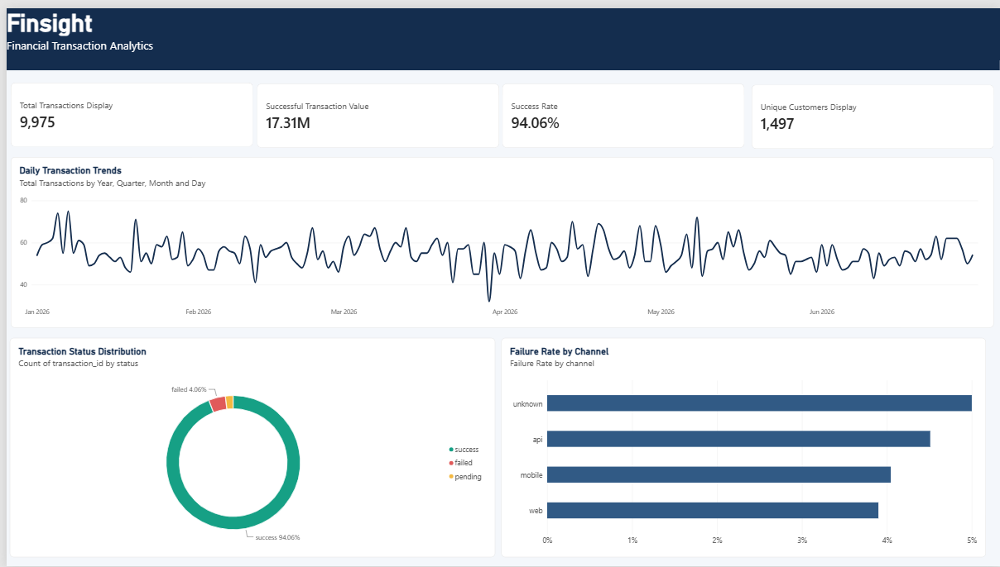

# FinSight — Financial Transaction Analytics Dashboard

**An end-to-end Business Intelligence project using Python, SQL, DuckDB, and Power BI.**

FinSight is a financial transaction analytics project designed to demonstrate how raw transaction data can be cleaned, analyzed, and transformed into actionable business insights through an interactive Power BI dashboard.

The project covers the complete analytics workflow, from data generation and preprocessing to SQL-based analysis and dashboard visualization.

> **Note:** This project uses simulated transaction data for educational and portfolio purposes. It does not use actual customer or transaction data from any financial services company.

## Dashboard Preview



## Project Objectives

- Build a reproducible data-cleaning pipeline using Python.
- Handle missing values, duplicate records, and inconsistent text values.
- Use SQL to analyze transaction performance and customer activity.
- Calculate business KPIs, including transaction success rate and successful transaction value.
- Develop a Power BI dashboard to communicate key findings visually.
- Demonstrate an end-to-end BI workflow using simulated financial data.

## Tech Stack

| Technology | Purpose |
|---|---|
| Python | Data generation, cleaning, and preprocessing |
| Pandas | Data manipulation and transformation |
| SQL | Business analysis and KPI calculations |
| DuckDB | SQL-based analytical queries |
| Power BI | Interactive dashboard and data visualization |
| Git & GitHub | Version control and project documentation |

## Project Workflow

```text
Simulated Transaction Data
          |
          v
Python ETL Pipeline
          |
          v
Data Cleaning and Validation
          |
          v
Cleaned Transaction CSV
          |
          v
SQL Analysis with DuckDB
          |
          v
Power BI Dashboard
          |
          v
Business Insights
```

## Dataset Overview

The project generates simulated financial transaction records containing transaction-level and customer-level information.

The dataset includes fields such as:

- `transaction_id` — unique transaction identifier
- `customer_id` — customer identifier
- `amount` — transaction amount
- `status` — transaction outcome, such as success, failed, or pending
- `channel` — transaction channel, such as mobile, web, or API
- `transaction_date` — date of the transaction
- `transaction_type` — transaction category

The generated raw dataset contains 10,015 rows, including deliberately introduced data-quality issues.

## Data Cleaning and ETL

The Python ETL pipeline is implemented in `src/pipeline.py`.

The pipeline performs the following operations:

1. Generates simulated transaction records.
2. Introduces sample data-quality issues for testing.
3. Identifies and removes duplicate transaction records using `transaction_id`.
4. Removes records with missing critical values.
5. Handles missing channel values by replacing them with `unknown`.
6. Normalizes text values for consistency.
7. Exports the cleaned dataset to `data/processed/transactions_clean.csv`.

### Data Quality Results

| Metric | Result |
|---|---:|
| Raw records | 10,015 |
| Records after cleaning | 9,975 |
| Records removed | 40 |
| Duplicate transaction IDs after cleaning | 0 |
| Missing values after cleaning | 0 |

These results demonstrate how preprocessing can improve data consistency before analysis.

## SQL Analysis

The SQL queries are available in `sql/analysis.sql` and are designed to analyze transaction performance from multiple business perspectives.

The analysis covers:

- **Overall KPIs:** Total transactions, unique customers, success rate, and successful transaction value.
- **Transaction status:** Distribution of successful, failed, and pending transactions.
- **Daily trends:** Changes in transaction volume over time.
- **Transaction type:** Transaction performance across different categories.
- **Channel performance:** Transaction outcomes and failure rates by channel.

## Key Findings

Based on the cleaned simulated dataset:

| KPI | Result |
|---|---:|
| Total transactions | 9,975 |
| Unique customers | 1,497 |
| Successful transactions | 9,382 |
| Failed transactions | 405 |
| Pending transactions | 188 |
| Transaction success rate | 94.06% |
| Successful transaction value | 17,310,139.80 |

### Transaction Status Distribution

- Success: 9,382 transactions (94.06%)
- Failed: 405 transactions (4.06%)
- Pending: 188 transactions (1.88%)

### Failure Rate by Channel

| Channel | Failure Rate |
|---|---:|
| Unknown | 5.00% |
| API | 4.51% |
| Mobile | 4.05% |
| Web | 3.90% |

The `unknown` channel has the highest observed failure rate in this simulated dataset. However, it contains only 20 transactions, so this rate should be interpreted cautiously.

**Important:** These are descriptive findings from simulated data, not evidence of real-world financial performance.

## Power BI Dashboard

The Power BI report presents the analysis through four KPI cards and three visualizations.

### KPI Cards

- Total Transactions
- Unique Customers
- Success Rate
- Successful Transaction Value

### Visualizations

- **Daily Transaction Trends:** Tracks transaction volume over time.
- **Transaction Status Distribution:** Shows the proportion of successful, failed, and pending transactions.
- **Failure Rate by Channel:** Compares transaction failure rates across channels.

The dashboard uses a navy-and-white color scheme with green, red, and amber status indicators to make key metrics easier to interpret.

## Repository Structure

```text
FinSight/
├── data/
│   └── processed/
│       └── transactions_clean.csv
├── src/
│   └── pipeline.py
├── sql/
│   └── analysis.sql
├── images/
│   └── finsight-dashboard.png
├── requirements.txt
└── README.md
```

The `images/` directory is for the dashboard screenshot. Add this directory and image when preparing the repository.

## Getting Started

### Prerequisites

- Python 3.10 or a compatible Python version
- Git
- Power BI Desktop for viewing or modifying the dashboard
- A SQL environment that supports DuckDB

### 1. Clone the repository

```bash
git clone https://github.com/vaibhavipawar27/FinSight.git
cd FinSight
```

### 2. Create a virtual environment

```bash
python -m venv .venv
```

Activate it on Windows:

```bash
.venv\Scripts\activate
```

### 3. Install dependencies

Create a `requirements.txt` containing the packages used by your pipeline, for example:

```text
pandas
duckdb
```

Install them with:

```bash
pip install -r requirements.txt
```

If your code uses additional libraries, include those in the requirements file as well.

### 4. Run the ETL pipeline

```bash
python src/pipeline.py
```

The pipeline generates the simulated data, performs the cleaning operations, and exports the processed CSV to:

```text
data/processed/transactions_clean.csv
```

### 5. Run the SQL analysis

Open `sql/analysis.sql` in your DuckDB-compatible SQL environment and execute the queries against the cleaned dataset. Configure the input path or table registration according to your SQL execution setup.

### 6. Open the Power BI report

Open your `.pbix` report in Power BI Desktop and connect it to `data/processed/transactions_clean.csv` if required.

Refresh the data to reproduce the dashboard using the cleaned dataset.

## Future Improvements

Potential extensions include:

- Add interactive date, channel, status, and transaction-type filters.
- Create a dedicated data-quality report.
- Compare transaction failure rates over time.
- Add anomaly detection to flag unusual transaction patterns.
- Automate data refresh and reporting.
- Add unit tests and validation checks for the ETL pipeline.

## Skills Demonstrated

- Python data preprocessing and ETL
- Data cleaning and quality validation
- SQL aggregations and business analysis
- DuckDB analytical queries
- KPI design and calculation
- Power BI dashboard development
- Data storytelling and documentation
- Git and GitHub project organization
